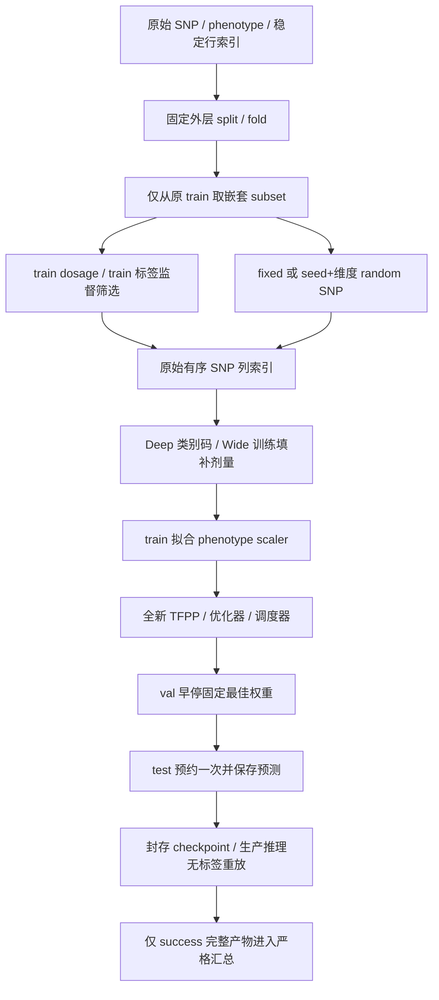
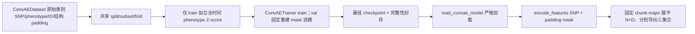

# Experiment Readiness — 第11步最终审计

## 基线与范围

- 审计 HEAD：`eb326d90fe65068403739ff7c71c183ac018d00e`。
- 第8步：`2babae87cc368d5a4fffe4c5f7140f683e70e39e`，独立 Ridge 探针提交。
- 第10步：上述 HEAD，独立 runner/追溯提交。审计开始工作区 clean，没有未提交的前序步骤。
- 只运行 CPU 合成输入和快速测试，未运行真实 SNP/表型、正式压缩或真实预测指标。
- 第9步 continuous_feature TFPP **未实现、未启用**；schema 明确拒绝，不能将连续特征送入离散 Embedding。
- 生产模块检索覆盖6个顶层 CLI、config/dataloader/trainer/model/utils/experiments 中的 phenotype、scaler、fit、筛选、分割、test 和 summarize 调用。旧本地忽略脚本不是正式入口。

## 环境

| 项目 | 实际版本 |
| --- | --- |
| OS | Linux 5.15.0-136-generic x86_64，glibc 2.35 |
| Python | 3.10.12 |
| PyTorch | 2.5.1+cu124 |
| NumPy / Pandas | 1.23.5 / 2.0.3 |
| SciPy / scikit-learn | 1.10.1 / 1.3.2 |
| Pydantic | 2.13.4 |

宿主检测 CUDA 可用，但测试模型均明确使用 CPU；CLI 合成训练设置 `CUDA_VISIBLE_DEVICES=''`、OMP/MKL线程=1。
未验证正式 GPU 训练的资源需求或跨设备位级一致性。

## 真实调用链与数据流



### 普通 TFPP 与 K折

- `train.py → TFPPTrainer.__init__ → TFPPDataset` 只加载原始输入；普通模式 `_prepare_regular_data()` 先固定 split。
- 只取 `train_idx`，显式解码类别为 dosage；筛选众数只 fit train。`utils.Screening.screen_snps()` 仅接收训练剂量和训练 phenotype。
- 原始列索引统一切片三组；Deep 中0=真实缺失、1/2/3=剂量0/1/2；Wide 使用训练众数恢复剂量再除以2，值在[0,1]。
- `get_dataloader()` 的表型归一化只 fit train，val/test 仅 transform；模型按筛选后维度创建，普通初始化与正式训练阶段显式使用 config.seed；ConvAE也重置训练mask/loader/dropout RNG。
- `_train_regular()` 调用现有训练/验证循环，只按 val loss 选择模型；非有限 val loss 立即失败。恢复最佳权重后 `_evaluate_test_set()` 预约并执行一次 test。
- K折 `_kfold_splits()` 用外层 KFold 和内层 train_test_split 产生固定角色；`_prepare_fold()` 创建独立 TFPPTrainer，复用上述完整流程。test 不参与内层验证选择。
- 各折权重、优化器、scheduler、scaler、筛选和填补独立；每样本恰好外层 test 一次。按折保留指标，统计有限值均值/std，`ddof=0`。
- 注意：某折 test 个体可能是另一折 train。test 改动不变性针对固定某折角色，不是要求所有折模型都忽略该个体。

### ConvAE 与导出



- ConvAE 是 Transformer masked autoencoder 的代码名称，不增加卷积层；辅助开关控制头与损失。
- `use_pheno_help=true` 用固定 `val_total_loss`，false 用 `val_recon_loss`。test 不进入模型选择。
- padding mask 独立于真实缺失类别，padding 不参与注意力/池化/随机目标/重建监督；真实缺失可编码但不作为重建标签。
- `export_convae.py → export_convae_features → load_convae_model → ConvAE.encode_features`。
- 编码 API 仅 SNP/mask，batch 包含 sample_id；不读表型 CSV，不调用辅助头/decoder，mask ratio=0，不消耗随机遮蔽。
- 加载 scaler 只用于验证训练产物完整性，不传入编码器。导出核对训练 genotype 指纹、split/配置、checkpoint 哈希；test genotype 可变且会进入新的数据哈希目录。
- 输出固定 `[N,num_chunks*d_ext]`，最后不完整 chunk 保留；按 manifest ID 恢复行序，拒绝重复/缺失/额外 ID。写完重新校验数组与哈希。

### Ridge、推理与 runner

- `ridge_convae.py → run_ridge_baseline → load_probe_export/load_role_targets → fit_probe`。
- feature scaler、phenotype scaler、9个 Ridge 候选均只 fit train；alpha 仅归一化 val MSE 选择，并列选较大者，不合并 val 重拟合。
- 选择完成才读取 test 标签，经 `evaluate_test_once` 产生一次评估。`load_ridge_probe/predict_probe` 无标签回放不增加正式评估次数。
- `infer.py → load_tfpp_model → load_inference_artifacts → prepare_test_data/prepare_inference_input → TFPP → denormalize_phenotype`。
- 只能用保存的 split/原始 SNP 索引/Wide 填充值/scaler；可选标签只 transform，不能 fit/筛选。raw/screened 必须显式声明，禁止按维度猜测。
- `run_experiments.py → spec.plan → run_unit`：固定/随机路线只生成索引；监督路线 `select_snps()` 编排真实 `gwas_screen/dc_sis_screen`。
- `RecordedTFPPTrainer` 仅包装生产 `TFPPTrainer` 的计时和 test 预约，没有复制训练算法。随后真实 `load_tfpp_model + infer.prepare_test_data()` 回放保存预测，不再读取 test 标签。
- `GWAS->DC-SIS` 始终将第一阶段原始列映射后的候选矩阵送入 DC-SIS。普通 `screen_snps()` 的小矩阵并集启发式保持原样，二者不能混称同一 method。
- ConvAE→Ridge 消费预先严格导出的匹配元数据/数组，经生产 `run_ridge_baseline()`，不在 runner 内发明另一种表征/回归器。

## 生产调用证据

`tests/test_readiness.py::test_six_routes_reach_real_cores_and_production_replay` 使用 wraps/记录器保留真实实现，实际执行40个体、13 SNP、train/val/test=24/8/8的六路线：

| 真实函数 | 成功测试中断言的调用证据 |
| --- | --- |
| `TFPPTrainer.train` | 5次，五条离散 TFPP 路线 |
| `gwas_screen` | 2次，GWAS 与串联第一阶段；仅24训练行、合法0/1/2 |
| `dc_sis_screen` | 2次；串联调用实际只接收5列 GWAS 候选，保留原始列映射 |
| `load_convae_model` | 1次，严格加载生成六路线所需 export 的模型 |
| `Ridge.fit` | 9次，每次仅24训练行 |
| `load_tfpp_model` | 5次，生产 checkpoint 无标签预测回放 |

实际维度从保存索引/特征记录读取：fixed/random/DC-SIS/串联为3，GWAS为5，ConvAE潜在D=8；这些是合成结构检查，不是性能指标。
现有 export 测试还以会抛错的替身确认编码时没有调用辅助头、decoder 或随机遮蔽。

## 审计确认与修复

1. 普通 TFPP 缺少 config.seed 初始化，可能使相同输入的权重依赖进程 RNG。现显式播种，训练阶段另重置 RNG，避免其他模型/提前检查batch的消耗影响轨迹；完整训练回归验证 test 标签/基因型改变不影响训练权重。
2. 公共 TFPP 常数 PCC=0 与 Ridge/runner NaN 不一致。现在统一公共函数，保留 NaN、有效/总列数和有效聚合数；负R²与时间校正定义不变。
3. 缺少训练 CSV 时间列顺序验证、非有限 val loss 可继续到错误选模。现保存时间列、验证多表型列同序/有限值、推理标签同序，并在选模前拒绝非有限 val loss。
4. 独立训练可覆盖已有权重并重复观察 test。现已有 checkpoint/test 预约拒绝覆盖，test 预约持久化；runner 独立预约文件防止仅回退 status count 后重测。
5. 同形状权重损坏原先不能在独立加载时检出。现在封存 checkpoint/配置/split/scaler/预处理哈希；当前生产加载器验证，缺失或损坏失败。
6. ConvAE 导出只核对形状，不能发现训练 SNP 内容被替换。现保存、核对原始有效训练 genotype 类别指纹；规范化为int64，避免 dtype 造成伪不匹配。
7. runner 之前只有内存预测，没有强制生产推理回放；汇总只核对CSV身份，未比对数值。现回放成为成功条件，CSV/NPZ/fold/统一指标重算一致才纳入。
8. ConvAE CLI batch_size=4 与配置2不一致，TFPP CLI 布尔拼写错误会静默变false。现默认值来自配置，布尔仅接受true/false。
9. schema/汇总显式记录 `metrics_protocol=time_adjusted_r2_nan_pcc_v2`、`std_ddof=0`、`replay_verified=true`；旧缺字段结果不补写追认。
10. `docs/` 原本全部忽略；只对本报告开放 Git 跟踪，其他本地 docs 继续忽略。

未改模型结构、注意力、门控、Legendre 算法、GWAS/DC-SIS数学定义或固定Ridge网格。

## 测试命令与实际结果

```bash
.venv/bin/python -B -m unittest discover -s tests -v
.venv/bin/python -B -m unittest discover -s tests -p test_readiness.py -v
git diff --check
```

- 完整152项测试通过，耗时75.705秒（含新增训练阶段RNG隔离回归和CPU合成子进程CLI）；不使用真实数据。
- 21个核心模块静态导入、49个生产Python文件AST解析通过；`git diff --check`通过。
- 独立CLI复核目录为`/tmp/dynags_step11_final`：smoke与另设输出目录的fresh run各成功执行六路线；dry-run前后文件集合不变；success resume不改变test预约；summarize接受6组、拒绝0组，全部`replay_verified=true`、`std_ddof=0`。
- 新增11项审计测试，覆盖完整普通/固定某折训练的权重不变性、ConvAE编码器/特征不变性、严格加载、无标签回放、生产调用证据、CSV数值损坏和test预约。
- 保留既有普通/K折/subset/scaler/填补/随机位点/alpha/导出确定性/legacy/哈希/dry-run零写入等141项测试。
- `test_all_supported_cli_help_and_synthetic_train_export_ridge_replay` 实际检查6个CLI和4个runner子命令的`--help`，在临时工作目录执行普通TFPP、2折、ConvAE训练/导出、Ridge和推理。
- `test_experiments.py` 实际执行dry-run CLI并比较前后文件集合，确认零结果写入；六路线合成结果通过严格summarize。
- 原始GT为0/1/2，真实缺失-1/NaN；筛选剂量0/1/2，Deep0/1/2/3与Wide训练填补/2边界测试保留。

可独立复现的 runner 命令（目录必须不存在）：

```bash
.venv/bin/python -B run_experiments.py smoke --directory /tmp/dynags_step11_smoke
.venv/bin/python -B run_experiments.py dry-run /tmp/dynags_step11_smoke/spec.json --development-smoke
.venv/bin/python -B run_experiments.py run /tmp/dynags_step11_smoke/spec.json --development-smoke --resume
.venv/bin/python -B run_experiments.py summarize /tmp/dynags_step11_smoke/runs/<hash>
```

正式数据命令模板与完整参数见README。模板中的真实路径未执行；同参数接口已通过上述合成CLI验证。

## 路线 readiness

| 路线 | 实现/CPU合成 | 正式启动条件 |
| --- | --- | --- |
| fixed_indices + TFPP | READY | 已固定原始列索引文件及SHA256，位点顺序有来源证明 |
| random_k + TFPP | READY | 固定k/seed，共享split/subset；随机选择不接收标签 |
| GWAS + TFPP | READY | 训练剂量合法、缺失策略明确，训练样本足以估计协变量模型 |
| DC-SIS + TFPP | READY | 训练剂量合法，固定联合/逐性状模式及k |
| GWAS→DC-SIS + TFPP | READY | 显式串联，记录两阶段与各性状贡献/去重；联合模式不伪造独立归因 |
| ConvAE→Ridge | READY | 对应trait/seed/subset/fold的当前封存checkpoint/export，显式ID标签文件 |
| ConvAE→continuous_feature TFPP | NOT READY / REJECTED | 第9步未实现，不得切到离散输入冒充 |
| 旧裸checkpoint/未封存历史结果/本地旧训练脚本 | NOT ELIGIBLE | 仅显式兼容或诊断，不能直接加入正式汇总 |

READY只表示代码/产物/合成防泄漏闭环可用，不表示真实数据、科学效果或运行预算已验证。

## 兼容性与剩余限制

- 有完整schema2/3预处理的旧TFPP可以诊断加载，未封存权重 `paper_eligible=false`；更旧缺产物者必须 `--legacy`，仍不具论文资格。
- 旧ConvAE裸state_dict/固定14维语义拒绝迁移。旧v2可诊断读，但未封存export不能进入新Ridge/runner正式流程。
- 旧runner清单缺统一指标协议、ddof、预约或回放字段时严格汇总拒绝。不能靠补写字段追认，应按当前代码重跑。
- `sample_id` 是稳定行索引，不是生物学个体ID；文件指纹能发现形式变化，不能证明原始个体/位点注释真实正确。
- runner对所有声明数据做文件SHA256校验，行/列重排也会拒绝。外部推理有意允许新输入；测试回放仅检查训练行指纹，无法以无ID文件识别“仅test行重排”与“test genotype变化”的生物学区别。
- val可改变早停/alpha选择；不得根据test结果扩网格、改模型或挑seed。数据缺失phenotype策略为error，不承诺非有限标签仍可训练。
- 成功resume只是校验/no-op；test前失败可新attempt从头开始，不支持中途优化器续训；test预约后失败必须人工审查，不自动重测。
- 公共R²在SS_tot近0时沿用0的未定义约定，正常负值不截断；PCC无有效列保留NaN。不同实验轴/普通split与fold、不同代码/数据/协议不能混合求均值。
- 旧模拟CSV训练器只保留兼容与编码/归一化测试，不是本次六条正式runner路线的替代入口。
- CPU峰值RSS是进程高水位；真实大数据与GPU资源/跨设备数值容差仍需独立预算，不在本次审计中运行。

## 正式实验前必须准备

1. 提交/审阅本次修改，锁定代码commit，正式工作区保持clean；开发smoke标志不能代替正式资格。
2. 准备原始SNP和各表型CSV真实路径、原始N/P、完整时间列名称/顺序与time_coordinates、trait set、seed。
3. 确认原始个体/位点顺序来源，保存文件SHA256、sample_id_source=row_index和顺序哈希；有生物学ID时需另行引入并校验。
4. 所有路线引用同一普通split或完整外层folds；固定嵌套train-size计划，只缩减train。
5. 固定筛选route/method id、联合或并集、k/gwas_k、missing策略、ablation、损失/早停；不要用test调整。
6. ConvAE须在对应train/subset/fold重新训练并由val选最佳，封存并导出；准备与export sample_ids逐组同序的Ridge标签NPZ。
7. 配置独立输出根目录、资源预算、不可覆盖与备份策略；保留schema验证通过的全部产物与每折明细。
8. 先dry-run核对计划与依赖，再明确启动正式run。第9步继续禁用；报告中不得填写未经运行的真实预测指标。
